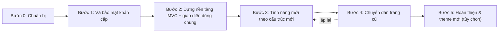

# Quy trình bảo trì & phát triển dự án Quản lý Đề tài

> Tài liệu đi kèm: [danh_gia_du_an.md](danh_gia_du_an.md), báo cáo chi tiết các lỗi kiến trúc, giao diện và bảo mật (mã S1–S8, H1–H7 dùng trong tài liệu này).
>
> Ngày lập: 20/11/2026

---

## Nguyên tắc chung

1. **Bảo mật trước, tính năng sau.** Không phát triển thêm khi hệ thống còn lỗ hổng cho phép chiếm quyền admin.
2. **Không viết lại toàn bộ một lần.** Chuyển đổi dần từng phần; hệ thống luôn chạy được.
3. **Code mới phải theo cấu trúc mới.** Không thêm file trộn SQL, HTML và CSS kiểu cũ.
4. **Trang cũ nào phải sửa thì chuyển trang đó sang cấu trúc mới.** Trang chưa đụng tới thì để nguyên.
5. **Giữ giao diện hiện tại, nhưng tổ chức lại để dễ đổi.** Làm cho giao diện dễ thay trước, rồi mới thay.
6. **Mỗi bước đều commit git** để có thể quay lại khi có lỗi.



---

## Bước 0: Chuẩn bị (khoảng nửa buổi)

- [ ] `git init`, commit toàn bộ bản hiện tại làm mốc: `git commit -m "Ban goc truoc bao tri"`.
- [ ] Export database hiện tại thành `database/schema.sql` (cấu trúc) và `database/seed.sql` (dữ liệu mẫu, không có dữ liệu thật).
- [ ] Sửa `BASE_URL` và `.htaccess` để chạy được trên localhost đúng thư mục hiện tại.
- [ ] Chặn truy cập web vào `bao_tri/` (`.htaccess`: `Require all denied`), hoặc không upload thư mục này lên hosting.
- [ ] Lập danh sách các luồng chính để tự kiểm tra sau mỗi bước (xem Phụ lục A).

## Bước 1: Vá bảo mật khẩn cấp (1–2 buổi, giữ nguyên cấu trúc)

| Mã | Việc cần làm |
|---|---|
| S1 | `register.php`: chỉ cho tự đăng ký vai trò **Sinh viên** (hoặc tắt hẳn đăng ký tự do). Tài khoản Giảng viên/Lãnh đạo chỉ do Lãnh đạo tạo. |
| S2 | `import_sinh_vien.php`, `import_giang_vien.php`: thêm `requireRole(ROLE_LANH_DAO)` và chuyển vào khu vực `lanh_dao/`. |
| S3 | `sua_ngay_thong_bao.php`: thêm `requireRole(ROLE_LANH_DAO)`. |
| S4 | Xóa `info.php`. Chuyển mọi mật khẩu sang `.env` (có `.env.example`). **Đổi mật khẩu DB InfinityFree và App Password Gmail.** |
| S5 | Không hiển thị OTP ra màn hình khi gửi mail lỗi (trừ khi đang chạy localhost). |
| S6 | Trang đặt lại mật khẩu phải kiểm tra `reset_token_expiry`; gộp 3 trang reset thành 1. |
| S7 | Thêm `csrf_field()` vào mọi form POST; kiểm tra token ở mọi file `xu_ly_*`, `xoa_*`. |
| S8 | Chuyển mọi thao tác xóa/duyệt/đăng ký từ GET sang POST + CSRF. |
| H2 | Bỏ chấp nhận MD5/plaintext; tài khoản cũ phải đặt lại mật khẩu. |
| H3 | OTP và captcha sinh bằng `random_int()`; giới hạn số lần nhập OTP. |
| H1 | Giới hạn số lần đăng nhập sai (ví dụ khóa 15 phút sau 5 lần sai). |
| H5 | Không in `$e->getMessage()` ra người dùng; ghi log thay vào đó. |
| H7 | Tách state OAuth riêng cho từng nhà cung cấp. |
| – | `.htaccess`: chặn truy cập trực tiếp vào `config/`, `models/`, `helpers/`, `vendor/`, `bao_tri/`. |

**Xong bước này khi:** người lạ không tạo được tài khoản admin, mọi thao tác thay đổi dữ liệu đều cần POST + CSRF, và trong code không còn mật khẩu.

## Bước 2: Dựng nền tảng (2–4 buổi)

### 2.1 Cấu trúc thư mục đích

```text
/
├── public/                 # Document root duy nhất
│   ├── index.php           # Front controller
│   ├── .htaccess
│   └── assets/
│       ├── css/
│       │   ├── theme/default.css   # Biến CSS (màu, font, bo góc...)
│       │   ├── app.css             # Style dùng chung
│       │   └── pages/*.css         # Style riêng (nếu thật cần)
│       ├── js/
│       └── img/
├── app/
│   ├── Core/               # Router, Controller, View, Database, Request, Session, Csrf, Auth
│   ├── Middleware/         # Auth, Role, Csrf
│   ├── Controllers/        # Auth/, SinhVien/, GiangVien/, LanhDao/, PublicController
│   ├── Services/           # Nghiệp vụ: DangKyService, DuyetService, OtpService, MailService...
│   ├── Models/             # Chỉ truy cập dữ liệu
│   └── Views/
│       ├── layouts/        # public.php, auth.php, dashboard.php
│       ├── components/     # card, table, badge, modal, form_field, flash, pagination, sidebar
│       └── pages/          # sinh_vien/, giang_vien/, lanh_dao/, auth/, public/
├── config/                 # Chỉ đọc từ .env
├── storage/                # logs/, uploads/ (không truy cập từ web)
├── database/               # schema.sql, seed.sql, migrations/
├── bao_tri/                # Tài liệu bảo trì
└── .env, .env.example, composer.json
```

> Trong giai đoạn chuyển đổi, các file cũ (`sinh_vien/`, `giang_vien/`, `lanh_dao/`...) **vẫn chạy song song** với cấu trúc mới.

### 2.2 Việc cần làm
- [ ] Composer autoload PSR-4 cho `app/` (bỏ `require_once` hàng loạt trong `bootstrap.php`).
- [ ] Đọc `.env` để lấy cấu hình (dùng `vlucas/phpdotenv` hoặc tự viết hàm đọc).
- [ ] `Core`: Router đơn giản, `Controller` cơ sở, `View::render()`, `Request`, `Csrf`, `Auth`.
- [ ] Middleware kiểm tra đăng nhập, vai trò và CSRF; khai báo theo route, không viết lặp ở từng trang.
- [ ] Helper `e()` để escape mọi dữ liệu khi xuất ra HTML.
- [ ] Bỏ `sanitize()` trước khi lưu DB: **lưu dữ liệu gốc, escape khi hiển thị.**
- [ ] `BaseModel`: whitelist cột khi insert/update/orderBy; hỗ trợ transaction.

### 2.3 Giao diện dùng chung (giữ nguyên hình thức hiện tại)
- [ ] Gom màu, font, bo góc… thành biến CSS trong `theme/default.css`.
- [ ] Gom Bootstrap/Icons về **một chỗ duy nhất** trong layout (hiện đang lặp 61 lần).
- [ ] Tạo 3 layout: `public` (trang chủ, giới thiệu), `auth` (đăng nhập, đăng ký, OTP, reset), `dashboard` (sidebar tự đổi theo vai trò).
- [ ] Tạo các component: `flash`, `status_badge`, `table`, `pagination`, `modal_confirm`, `form_field`, `card`, `empty_state`, `sidebar`.
- [ ] Tách `<style>` và `<script>` trong trang ra `assets/`.

**Xong bước này khi:** có ít nhất một trang mẫu chạy hoàn toàn theo luồng Route → Middleware → Controller → Service/Model → View (layout + component).

## Bước 3: Tính năng mới (liên tục)

Mỗi tính năng mới phải theo checklist:

- [ ] Khai báo route (kèm middleware vai trò và CSRF).
- [ ] Controller chỉ nhận request, gọi Service và trả về View hoặc JSON.
- [ ] Nghiệp vụ đặt trong Service; SQL đặt trong Model (dùng prepared statement).
- [ ] View dùng layout và component có sẵn; không có `<style>` hoặc SQL trong view; mọi biến xuất ra đều qua `e()`.
- [ ] Form POST có `csrf_field()`; không dùng GET để thay đổi dữ liệu.
- [ ] Kiểm tra quyền sở hữu dữ liệu (IDOR), ví dụ giảng viên chỉ sửa được đề tài của mình.
- [ ] Thao tác nhiều bước dùng transaction.
- [ ] Nếu đổi DB thì thêm file vào `database/migrations/`.
- [ ] Tự kiểm tra theo Phụ lục A, rồi commit.

## Bước 4: Chuyển dần trang cũ (song song với bước 3)

**Quy tắc:** trang cũ nào phải sửa (sửa lỗi hoặc thêm chức năng) thì chuyển trang đó sang cấu trúc mới.

Thứ tự ưu tiên khi chủ động chuyển:

| Thứ tự | Module | Lý do |
|---|---|---|
| 1 | **Auth** (login, register, OTP, reset, OAuth) | Nhiều lỗi bảo mật; 7 trang lặp giao diện; dùng chung layout `auth` |
| 2 | **Sinh viên** | Ít trang, luồng đơn giản; xử lý race condition khi đăng ký đề tài |
| 3 | **Giảng viên** | Tạo/sửa/duyệt đề tài; nhiều thao tác GET cần sửa |
| 4 | **Lãnh đạo** | Nhiều file lớn (1000–1700 dòng); tách thành nhiều controller/view nhỏ |
| 5 | **Trang công khai** (index, giới thiệu, thông báo) | Gộp 3 trang giới thiệu gần giống nhau; tách `index.php` (3800 dòng) |

Mỗi trang khi chuyển:
1. Tạo route, controller, service và view mới.
2. Chuyển SQL từ trang cũ vào Model.
3. Kiểm tra chức năng khớp với bản cũ.
4. Cho file cũ chuyển hướng (301) sang route mới, rồi xóa file cũ sau khi chạy ổn định.
5. Commit.

## Bước 5: Hoàn thiện (sau khi chuyển xong phần lớn)

- [ ] Xóa các file trùng hoặc rác: `login_*.php`, `new_reset.php`, `giang_vien_chi_tiet_v2.php`, `api/notifications.php` (nếu không dùng)...
- [ ] Bổ sung header bảo mật (CSP, HSTS khi có HTTPS).
- [ ] Viết `README` mới: cài đặt, cấu hình `.env`, import database.
- [ ] **(Tùy chọn) Làm giao diện mới:** tạo `theme/<ten_moi>.css` và (nếu cần) layout mới, chọn theme qua config, dùng thử song song rồi mới chuyển hẳn. Không cần sửa từng trang.

---

## Phụ lục A: Danh sách tự kiểm tra sau mỗi lần thay đổi

| Vai trò | Luồng cần thử |
|---|---|
| Khách | Xem trang chủ, danh sách đề tài công khai, thông báo; không truy cập được trang nội bộ |
| Xác thực | Đăng ký SV + OTP; đăng nhập/đăng xuất; quên và đặt lại mật khẩu; đăng nhập Google/Microsoft |
| Sinh viên | Xem đề tài, đăng ký, hủy đăng ký, xem "đề tài của tôi"; không đăng ký vượt giới hạn |
| Giảng viên | Tạo/sửa/xóa đề tài nháp, gửi duyệt, duyệt/từ chối sinh viên, xuất báo cáo |
| Lãnh đạo | Duyệt đề tài, tạo/import người dùng, cài đặt thông số, quản lý thông báo, phân công chấm, xuất báo cáo |
| Bảo mật | Truy cập chéo vai trò bị chặn; form thiếu CSRF bị từ chối; dữ liệu có `<script>` hiển thị dạng chữ |

## Phụ lục B: Quy ước code

- Tên file/class: `PascalCase` cho class (`DeTaiController`), `snake_case` cho view (`danh_sach.php`).
- Không có SQL ngoài `app/Models/`.
- Không có `<style>` hoặc `<script>` dài trong view; không ghi mã màu cứng, dùng biến CSS.
- Mọi output HTML qua `e()`. Mọi form POST có CSRF.
- Không ghi mật khẩu hay khóa bí mật vào code; dùng `.env`.
- Commit nhỏ, có thông điệp rõ ràng: `fix(auth): ...`, `feat(sinh_vien): ...`, `refactor(lanh_dao): ...`.
